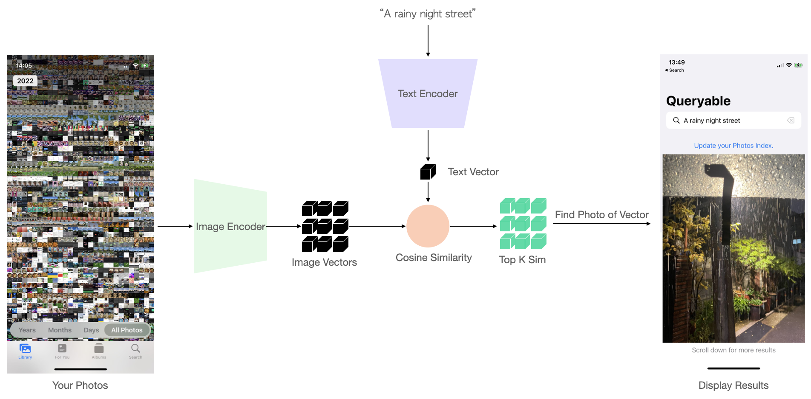

# Queryable

The open-source code of **Queryable**, an offline photo search app for iPhone and iPad (iOS 18 or later). Describe a photo in your own words, such as `a brown dog sitting on a bench`, and Apple's [MobileCLIP](https://github.com/apple/ml-mobileclip) model finds it on the device. Your photos are never uploaded.

[Blog](https://mazzzystar.com/2022/12/29/Run-CLIP-on-iPhone-to-Search-Photos/) | [App Store](https://apps.apple.com/app/apple-store/id1661598353?pt=128849838&ct=github-readme&mt=8) | [Website](https://queryable.app/) | [Story](https://mazzzystar.com/2024/07/21/Two-Years-of-an-AI-Photo-Album-Search-App/) | [故事](https://mazzzystar.com/2024/07/21/Two-Years-of-an-AI-Photo-Album-Search-App-zh/)

## How does it work?

- Encode all album photos using the CLIP Image Encoder, compute image vectors, and save them.
- For each new text query, compute the corresponding text vector using the Text Encoder.
- Compare the similarity between this text vector and each image vector.
- Rank and return the top K most similar results.

The process is as follows:

For more details, please refer to my blog: [Run CLIP on iPhone to Search Photos](https://mazzzystar.com/2022/12/29/Run-CLIP-on-iPhone-to-Search-Photos/).

# Updates

[2024-09-01]: Now supports Apple's [MobileCLIP](https://github.com/apple/ml-mobileclip).

You can download the exported `TextEncoder_mobileCLIP_s2.mlmodelc` and `ImageEncoder_mobileCLIP_s2.mlmodelc` from [Google Drive](https://drive.google.com/drive/folders/12ze3UcqrXt9qeySGh_j_zWE-PWRDTzJv?usp=drive_link). Currently we use `s2` model as the default model, which balances both efficiency & precision.

## [PicQuery](https://github.com/greyovo/PicQuery)(Android)

The Android version([Code](https://github.com/greyovo/PicQuery)) developed by [@greyovo](https://github.com/greyovo), which supports both English and Chinese. See details in [#12](https://github.com/mazzzystar/Queryable/issues/12).

## Run on Xcode

Download the `TextEncoder_mobileCLIP_s2.mlmodelc` and `ImageEncoder_mobileCLIP_s2.mlmodelc` from [Google Drive](https://drive.google.com/drive/folders/12ze3UcqrXt9qeySGh_j_zWE-PWRDTzJv?usp=drive_link).
Clone this repo, put the downloaded models below `CoreMLModels/` path and run Xcode, it should work.

## Core ML Export

> If you only want to run Queryable, you can **skip this step** and directly use the exported model from [Google Drive](https://drive.google.com/drive/folders/12ze3UcqrXt9qeySGh_j_zWE-PWRDTzJv?usp=drive_link). If you wish to implement Queryable that supports your own native language, or do some model quantization/acceleration work, here are some guidelines.

The trick is to separate the `TextEncoder` and `ImageEncoder` at the architecture level, and then load the model weights individually. Queryable uses the ~~OpenAI [ViT-B/32](https://github.com/openai/CLIP)~~ Apple's [MobileCLIP](https://github.com/apple/ml-mobileclip) model, and I wrote a [Jupyter notebook](https://github.com/mazzzystar/Queryable/blob/main/PyTorch2CoreML.ipynb) to demonstrate how to separate, load, and export the OpenAI's CLIP Core ML model(If you want the MobileCLIP's export script, checkout [#issuecomment-2328024269](https://github.com/mazzzystar/Queryable/issues/45#issuecomment-2328024269)). The export results of the ImageEncoder's Core ML have a certain level of precision error, and more appropriate normalization parameters may be needed.

- Update (2024/09/01): The default model is now Apple's [MobileCLIP](https://github.com/apple/ml-mobileclip). Exported Model: [Google Drive](https://drive.google.com/drive/folders/12ze3UcqrXt9qeySGh_j_zWE-PWRDTzJv?usp=drive_link)
- Update (2023/09/22): Thanks to [jxiong22](https://github.com/jxiong22) for providing the [scripts](https://github.com/mazzzystar/Queryable/blob/main/PyTorch2CoreML-HuggingFace.ipynb) to convert the HuggingFace version of `clip-vit-base-patch32`. This has significantly reduced the precision error in the image encoder. For more details, see [#18](https://github.com/mazzzystar/Queryable/pull/18).

## Contributions

> Disclaimer: I am not a professional iOS engineer, please forgive my poor Swift code. You may focus only on the loading, computation, storage, and sorting of the model.

You can apply Queryable to your own product, but I don't recommend simply modifying the appearance and listing it on the App Store.
If you are interested in optimizing certain aspects(such as https://github.com/mazzzystar/Queryable/issues/4, ~~https://github.com/mazzzystar/Queryable/issues/5~~, https://github.com/mazzzystar/Queryable/issues/6, https://github.com/mazzzystar/Queryable/issues/10, https://github.com/mazzzystar/Queryable/issues/11, ~~https://github.com/mazzzystar/Queryable/issues/12~~), feel free to submit a PR (Pull Request).

- Thanks to [
  Chris Buguet](https://github.com/codingstyle), the issue (https://github.com/mazzzystar/Queryable/issues/5) where devices below iPhone 11 couldn't run has been fixed.
- [greyovo](https://github.com/greyovo) has completed the Android app(https://github.com/mazzzystar/Queryable/issues/12) development: [Google Play](https://play.google.com/store/apps/details?id=me.grey.picquery). The author stated that the code will be released in the future.
- [yujinqiu](https://github.com/yujinqiu) has developed the macOS version named [Searchable](https://www.engineerdraft.com/en/searchable/)(not open-sourced), which supports full-disk search. See [#4](https://github.com/mazzzystar/Queryable/issues/4#issuecomment-1990979537)

Thank you for your contribution : )

If you have any questions/suggestions, here are some contact methods: [Discord](https://discord.com/invite/R3wNsqq3v5) | [Twitter](https://twitter.com/immazzystar) | [Reddit: r/Queryable](https://www.reddit.com/r/Queryable/).

## License

MIT License

Copyright (c) 2023 Ke Fang
